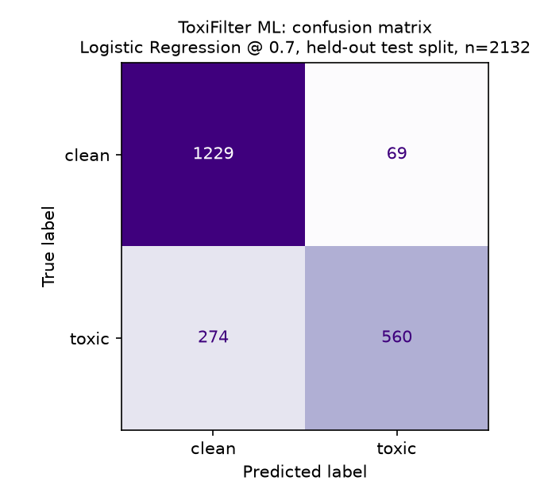
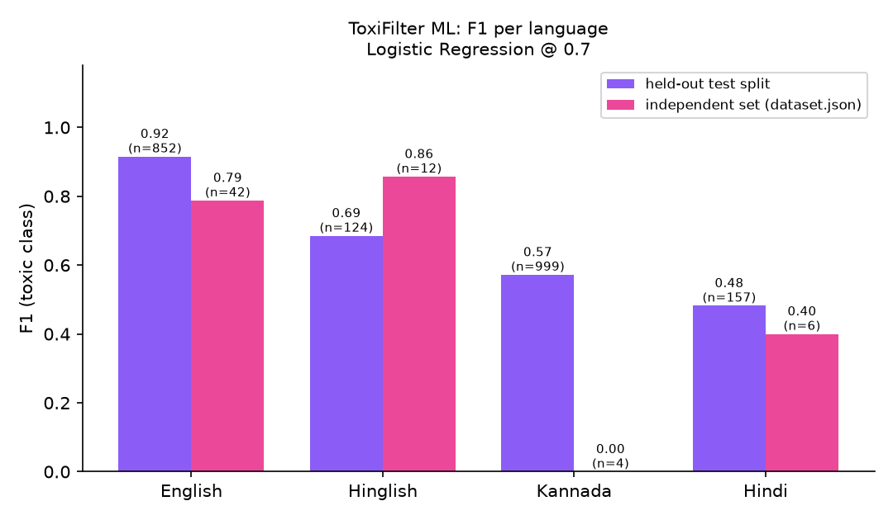

# Evaluation of the ToxiFilter ML model

This chapter describes how the machine-learning component of ToxiFilter was trained and evaluated:
which public datasets were used, how they were prepared, which models were compared, and how well the
chosen model works, overall, per language, and on an independent test set. It also reports honestly
where the model is weak.

Everything here can be reproduced with the commands in [section 8](#8-reproducing-the-results). All
numbers come from `ml/metrics.json`, `ml/pipeline_on_heldout.json` and the output of `npm run eval -- --full`.

## 1. Summary

| | |
|---|---|
| **Task** | Binary classification of a single comment as toxic (hateful / offensive) or clean |
| **Languages** | English, Hinglish (Hindi in Latin letters), Hindi (Devanagari), Kannada (including Kannada-English code-mixing) |
| **Training data** | 10,660 comments from three public datasets (section 2) |
| **Model** | TF-IDF character n-grams (2-5) + word n-grams (1-2) → Logistic Regression (`class_weight="balanced"`), decision threshold 0.7 |
| **Held-out test split** (2,132 comments) | precision **0.890**, recall **0.671**, F1 **0.766** |
| **5-fold cross-validation** | F1 0.785 ± 0.013 |
| **Per-language F1** (held-out) | English 0.916, Hinglish 0.685, Kannada 0.572, Hindi 0.482 |
| **Independent test set** (`server/eval/dataset.json`, 64 comments, never trained on) | precision 1.000, recall 0.588, F1 0.741, 0 false alarms on 30 clean comments (selection-time model) |
| **Does it help the app?** | Yes. On held-out real data the keyword engine alone reaches F1 0.575; adding the ML model raises it to 0.771 (recall 0.414 → 0.693) |

Three findings matter most:

1. **The model works well for English (F1 0.92) but only moderately for the code-mixed and Indian-language data** (F1 0.48-0.69). That is partly the model and partly the data: the Kannada and Hindi labels are noisy and the Hinglish and Hindi sets are small.
2. **The hand-written keyword engine scores 100% on its own development set but only 57.5% F1 on real held-out comments**, and 3-16% F1 on Hinglish, Kannada and Hindi. The 100% figure measured memorisation of a set the lexicon was tuned on. The ML model supplies most of the real-world coverage.
3. **A tiny dataset cannot be evaluated honestly.** A model trained only on the 64 hand-written comments leaves about 13 comments to test on, and scoring it on its own training file always looks perfect. Only the held-out and independent numbers in this chapter should be quoted.

## 2. Data

### 2.1 Sources

| Language | Dataset | Where | Licence | Raw size |
|---|---|---|---|---|
| Kannada-English (code-mixed) | **DravidianCodeMix / KanCMD**, offensive-language task, Kannada config (YouTube comments) | [`community-datasets/offenseval_dravidian`](https://huggingface.co/datasets/community-datasets/offenseval_dravidian) on the Hugging Face Hub | CC-BY-4.0 | 6,217 train + 777 validation = 6,994 |
| English | **Davidson et al. (2017)**, hate speech and offensive language (tweets) | [`tdavidson/hate_speech_offensive`](https://huggingface.co/datasets/tdavidson/hate_speech_offensive); original repository [t-davidson/hate-speech-and-offensive-language](https://github.com/t-davidson/hate-speech-and-offensive-language) | MIT in the original repository (the Hub card says "unknown") | 24,783 |
| Hindi and Hinglish | **HASOC 2021**, sub-task 2: identification of conversational hate speech in code-mixed languages (Hindi-English tweets with replies) | [`nikitadesai/hasoc`](https://huggingface.co/datasets/nikitadesai/hasoc), an unofficial re-upload. Official source: the HASOC organisers, [hasocfire.github.io](https://hasocfire.github.io) | The re-upload's card says CC-BY-NC-4.0 (non-commercial). The original data is distributed under the shared-task terms, and the re-upload's right to apply that licence could not be verified | 4,914 rows |

All three download without registration. Because the HASOC copy is an unofficial re-upload with a
non-commercial licence, the model trained on it should be treated as **for academic use only**. For any
other use, obtain the data from the HASOC organisers.

**Dataset that was tried and rejected.**

| Dataset | Why it was not used |
|---|---|
| Bohra et al. (2018) Hindi-English hate speech, GitHub `deepanshu1995/HateSpeech-Hindi-English-Code-Mixed-Social-Media-Text` | The repository contains only tweet IDs (the authors state that, because of Twitter's policy, the text is available only by e-mail request). No text, so it is unusable. |
| `pranjali94/HASOC2020_Roman` | One text column, no labels. |
| `md-nishat-008/Code-Mixed-Offensive-Language-Detection-Dataset` | Licence is CC-BY-NC-**ND** (no derivatives). |
| `Paul/hatecheck-hindi` | Synthetic template sentences from a diagnostic test suite, not real comments. |
| `Polygl0t/hindi-toxicity-qwen-annotations` | Labels produced by a language model on web articles, not human-labelled comments. |

### 2.2 Preparation (`ml/prepare_data.py`)

1. **Labels** were mapped to 0 (clean) / 1 (toxic).
   - Kannada: `Not_offensive` → 0; the four `Offensive_*` classes → 1; `not-Kannada` → dropped (1,713 rows).
   - Davidson: class 0 (hate) and 1 (offensive) → 1; class 2 (neither) → 0.
   - HASOC: the label belongs to the *last* item of a "parent tweet → comment → reply" chain, so only the text after the last `COMMENT::` / `REPLY-COMMENT` marker is kept. Rows labelled `CHOF` (hateful only *given the parent post*) were dropped (888 rows), because ToxiFilter judges a comment on its own. `SHOF` → 1, `NONE` → 0.
2. **Cleaning**: HTML entities decoded; URLs, `@mentions` and `RT` removed; `#` stripped from hashtags; whitespace collapsed; rows shorter than 3 characters or without a letter removed (80 rows).
3. **Duplicates** (909) were removed. Texts that appear with **conflicting labels** (181) were removed completely.
4. **Language tag.** Kannada and English come from their source. HASOC rows containing Devanagari are `hi`; Latin-script HASOC rows are tagged `hinglish` if they contain at least two distinct romanised-Hindi function words (or one such word making up 15% of a short text), otherwise `en`. This is a heuristic, not a language identifier.
5. **English was capped at 40% of the data** and balanced 50/50 toxic/clean inside the cap. 83% of Davidson's tweets are labelled hate or offensive, which would otherwise teach the model that English text means toxic and drown out the smaller languages.
6. **The independent test set was kept out.** `server/eval/dataset.json` is never used for training; the script also checks for and removes any overlapping text (none found).

### 2.3 Final composition

| Language | Comments | Toxic | Clean | Share of data |
|---|---:|---:|---:|---:|
| English | 4,264 | 2,132 | 2,132 | 40.0% |
| Hindi (Devanagari) | 783 | 351 | 432 | 7.3% |
| Hinglish | 620 | 396 | 224 | 5.8% |
| Kannada(-English) | 4,993 | 1,293 | 3,700 | 46.8% |
| **Total** | **10,660** | **4,172 (39.1%)** | **6,488** | 100% |

Hinglish and Hindi are the smallest parts of the data. That limits what can be concluded about them.

## 3. Method

**Features.** Text is normalised (lower-case, leetspeak mapped back with `0→o 1→i 3→e 4→a 5→s @→a $→s`,
letters repeated three or more times collapsed, e.g. `fuuuck → fuck`), then converted to TF-IDF vectors:
character n-grams of length 2-5 inside word boundaries (`char_wb`), which tolerate misspellings and
transliteration, plus word n-grams of length 1-2. N-grams seen in fewer than two documents are ignored. A custom
tokenizer keeps Hindi and Kannada words in one piece (the default tokenizer splits them at vowel signs).

**Models compared.**

- **Logistic Regression** (`C=10`, `class_weight="balanced"`).
- **Calibrated LinearSVC** (`class_weight="balanced"`, sigmoid calibration, 3 folds) as a second model; a
  plain LinearSVC does not output probabilities.

**Split.** A stratified 80/20 split, stratified by **language and label together** (8,528 train / 2,132 test,
`random_state=42`). The held-out 20% is used for every number in sections 4.1-4.4.

**Thresholds.** For both models the decision thresholds 0.5, 0.6 and 0.7 were tried.

**Selection rule** (fixed before the final run, apart from the tie tolerance noted below):

> choose the (model, threshold) option with the highest held-out F1 among those that produce **at most one
> false alarm on the 30 clean comments of the independent set**.

The false-alarm guard reflects the product: warning a user about a harmless comment is worse than missing a
borderline one. Options within 0.005 F1 of the best are treated as tied and resolved in favour of the simpler
logistic regression, then the higher threshold. *This tolerance was added after seeing a 0.0003 difference
between the two models in an earlier run, so it is a post-hoc choice, disclosed here.*

**Deployment.** The selected model is refit on all 10,660 comments before it is saved, so the running
service has seen slightly more data than the 80% model that was evaluated.

**Independent test set.** `server/eval/dataset.json` has 64 hand-written comments (34 toxic, 30 clean; English 42,
Hinglish 12, Hindi 6, Kannada 4). It was never trained on. Two caveats: it is tiny, so per-language numbers there
are very noisy; and its *clean rows* were used as the false-alarm guard in the selection rule, so it is not a
perfectly untouched test for the threshold choice.

## 4. Results

### 4.1 Model and threshold comparison

Scored on the 2,132-comment held-out split; the last two columns use the independent set.

| Model | Threshold | Precision | Recall | **F1** | Independent F1 | False alarms (of 30 clean) |
|---|---:|---:|---:|---:|---:|---:|
| Logistic Regression | 0.5 | 0.806 | 0.771 | 0.788 | 0.754 | 4 |
| Logistic Regression | 0.6 | 0.855 | 0.718 | 0.780 | 0.737 | 2 |
| **Logistic Regression** | **0.7** | **0.890** | **0.671** | **0.766** | **0.741** | **0** |
| Calibrated LinearSVC | 0.5 | 0.844 | 0.753 | 0.796 | 0.759 | 2 |
| Calibrated LinearSVC | 0.6 | 0.887 | 0.677 | 0.768 | 0.717 | 0 |
| Calibrated LinearSVC | 0.7 | 0.921 | 0.606 | 0.731 | 0.640 | 0 |

**5-fold stratified cross-validation (F1, all data, threshold 0.5):** Logistic Regression 0.785 ± 0.013,
Calibrated LinearSVC 0.785 ± 0.015.

The two models are **statistically indistinguishable**: their cross-validated F1 is identical and their
held-out F1 differs by less than 0.01 at every threshold. Logistic Regression was kept because it is simpler,
faster and produces probabilities directly. The threshold matters more than the model. Lowering the
threshold to 0.5 gives the best F1 (0.788) but produces 4 false alarms on 30 clean comments (13%), which the
selection rule rejects. **The chosen setting is Logistic Regression at threshold 0.7**, trading about 0.02 F1
for far fewer false alarms.

### 4.2 Chosen model on the held-out split

Precision 0.890, recall 0.671, F1 0.766, accuracy 0.839.



| | Predicted clean | Predicted toxic |
|---|---:|---:|
| **Actually clean** | 1,229 | 69 |
| **Actually toxic** | 274 | 560 |

The model is cautious: of 834 toxic comments it finds 560 (recall 0.67), and when it flags something it
is right 89% of the time.

### 4.3 Per-language results

Held-out split, chosen model:

| Language | Comments | Precision | Recall | **F1** |
|---|---:|---:|---:|---:|
| English | 852 | 0.971 | 0.866 | **0.916** |
| Hinglish | 124 | 0.766 | 0.620 | **0.685** |
| Kannada | 999 | 0.804 | 0.444 | **0.572** |
| Hindi | 157 | 0.643 | 0.386 | **0.482** |



(The pink bars are the independent set. They rest on 42, 12, 4 and 6 comments, so only the English bar is
meaningful.)

The pattern is consistent: high precision but low recall for Kannada and Hindi. The model rarely flags a clean
comment but misses many toxic ones. Probable causes: (a) label noise: code-mixed offensive-language corpora are hard to annotate (annotators judge several languages and scripts at once), and labels that cannot be predicted from the text cap the achievable score (section 6); (b) the
Hindi set has only 783 rows; (c) Kannada text mixes Kannada script, romanised Kannada and English, so
character n-grams are spread thin.

### 4.4 Independent test set

`server/eval/dataset.json`, 64 comments the model was never trained on.

| Model | Precision | Recall | F1 | False alarms (of 30 clean) |
|---|---:|---:|---:|---:|
| 80% model used for selection (threshold 0.7) | 1.000 | 0.588 | 0.741 | 0 |
| **Deployed model** (refit on all data), `npm run eval -- --full` | 0.950 | 0.559 | 0.704 | 1 |

The deployed model flags one harmless sentence, "This bug is so stupid, took me hours". Per language
(deployed model): English F1 0.727 (n=42), Hinglish 0.857 (n=12), Hindi 0.400 (n=6), Kannada 0.000 (n=4).
Four Kannada comments cannot support any conclusion; the held-out figure of 0.572 (n=999) is the one to use.

### 4.5 Does the ML model improve ToxiFilter? (held-out split)

On the held-out 2,132 comments, which neither the ML model nor the keyword lexicon were trained or tuned on
(`npm run eval:heldout`):

| System | Precision | Recall | F1 | False alarms |
|---|---:|---:|---:|---:|
| Keyword engine alone | 94.3% | 41.4% | 57.5% | 21 |
| ToxiFilter ML alone (≥ 0.7) | 89.0% | 67.1% | 76.6% | 69 |
| **Keyword OR ML (the running pipeline)** | 86.9% | 69.3% | **77.1%** | 87 |

F1 per language:

| System | English | Hinglish | Kannada | Hindi |
|---|---:|---:|---:|---:|
| Keyword engine alone | 83.7% | 16.3% | 10.9% | 2.8% |
| ToxiFilter ML alone | 91.6% | 68.5% | 57.2% | 48.2% |
| Keyword OR ML | 91.4% | 70.3% | 57.6% | 49.6% |

Reading the table:

- The **keyword engine is precise but narrow**. It is nearly useless on Hinglish, Kannada and Hindi *real-world*
  text (F1 3-16%), because its word list cannot anticipate every abusive phrase in those languages.
- The **ML model provides almost all of the real-world coverage**, especially outside English.
- **Combining them adds only a little** over ML alone (+0.5 F1, +2.2 points of recall) at the cost of 18
  more false alarms. The keyword engine's remaining value is in *explaining* decisions (category, severity,
  the exact words) and in reliably catching obvious profanity, not in accuracy.
- The keyword engine scores **100% on `dataset.json`** (section 4.4), but that file is where its lexicon was
  developed. On held-out data it scores 57.5%. The development-set number must not be presented as accuracy.

On `dataset.json` the combined pipeline scores 98.4% accuracy (F1 98.6%) against 100% for the keyword engine
alone, because the ML model adds the single false alarm described above. That file cannot show the ML model's
benefit, since the keyword engine has already saturated it.

### 4.6 Examples from the ToxiFilter Lab

Sent through the running API with the ML service enabled. "Decided by" is the provider whose score decided
the verdict (`source` in the API response).

| Text | ML probability | Flagged | Decided by |
|---|---:|---|---|
| `complete waste of space honestly` | 0.22 | no | none (missed) |
| `nobody wants to read your garbage` | 0.72 | yes | ToxiFilter ML (the keyword engine also flags it at 0.55) |
| `you are an idiot` | 0.57 | yes | keyword engine (ML is below its 0.7 threshold) |
| `Great post, thanks for sharing!` | 0.02 | no | none |
| `Gandhi had great skill` | 0.02 | no | none |
| *(first three offensive Kannada validation comments)* | 0.88-1.00 | yes | ToxiFilter ML |
| *(first three toxic Hinglish comments from the data)* | 0.98-0.99 | yes | ToxiFilter ML (one also matched keywords) |

The Kannada and Hinglish rows are drawn from the training data, so **they show that the service works, not that
the model generalises**. The first three lines are sentences typed by hand: one is missed, which illustrates
the recall limits above.

## 5. Statistical caution

With 2,132 test comments the standard error of an overall F1 near 0.77 is roughly 0.01-0.015 (the cross-validation standard deviation, 0.013, agrees). The per-language
figures rest on far fewer comments (124 Hinglish, 157 Hindi), so differences of a few points between those
languages are not significant. A single random split and a 5-fold cross-validation were used; no confidence
intervals were computed. The independent set has 64 comments and its per-language parts have 4-42.

## 6. Limitations

- **Label quality.** Annotating offensive content in code-mixed text is hard, and the labels are noisy. Some labels cannot be predicted from the comment alone, which HASOC's own `SHOF`/`CHOF` distinction (hateful on its own vs. only given the parent post) makes explicit. This limits the best achievable score, and was not measured here (no inter-annotator agreement was computed). The Kannada recall of 0.44 may partly reflect this. Davidson's "offensive" class is dominated by slang profanity in tweets, which does not match the tone of blog comments.
- **Domain shift.** The data is tweets and YouTube comments; ToxiFilter protects blog comments.
- **Bag-of-n-grams cannot read context.** TF-IDF with a linear classifier misses **sarcasm**, quoted abuse ("he called me an idiot"), negation, and insults without any abusive vocabulary ("complete waste of space honestly" scores 0.22). It also cannot resolve who a comment is aimed at.
- **Small Hinglish and Hindi sets** (620 and 783 comments) and a language tag for Hinglish that is a heuristic.
- **HASOC provenance.** An unofficial re-upload with a non-commercial licence, see section 2.1.
- **Threshold choice partly used the independent set** (its clean rows), and the 0.005 tie tolerance was added after the fact.
- **Deployed model differs slightly from the evaluated one** (refit on all data).
- **No calibration across languages**: a probability of 0.7 does not mean the same thing in Kannada and in English.
- **Adversarial robustness was not tested** beyond simple leetspeak normalisation.
- **Fairness**: the model may associate identity terms or dialect with toxicity (as is common in this family of datasets); no bias audit was done.

## 7. Future work

- **Fine-tune a multilingual transformer**, such as MuRIL, which was pre-trained on Indian languages including Hindi, Kannada and transliterated text (Khanuja et al., 2021). `ml/train_transformer.py` is written for this and is meant to run on a free Google Colab GPU; it has not been run in this project. A fine-tuned transformer should help with context and spelling variation, but needs a GPU and ideally more labelled data.
- **Collect more Hinglish and Hindi comments**, and label a held-out set of real blog comments with several annotators (so that an inter-annotator agreement and a genuinely in-domain test are available).
- **Learn from the platform itself**: reported and hidden comments are a source of labelled in-domain examples.
- **Add conversational context** (the post and previous comments), which the HASOC conversational task shows matters.
- **Calibrate probabilities per language** and choose a threshold for each.

## 8. Reproducing the results

```powershell
cd ml
python -m venv .venv
.venv\Scripts\activate
pip install -r requirements-data.txt
python prepare_data.py      # downloads the datasets, writes data/combined.csv and data/dataset_stats.json
python train.py             # trains, compares models and thresholds, writes metrics.json and the two charts
cd ..
npm run eval:heldout        # section 4.5 (keyword vs ML vs combined on the held-out split)
npm run dev                 # starts the API, web app and ML service, then: npm run eval -- --full
```

Training takes about a minute on a laptop CPU, and the model file is about 1.6 MB. The split, the models and the
selection are deterministic (`random_state=42`).

## 9. References

The BibTeX entries below for the three dataset papers were taken from the dataset cards on the Hugging Face Hub;
the cards omit some fields (publication year, volume, pages), so complete them from the publisher's page. Entries
marked with ‡ were assembled from search results and **must be checked** against the publisher or arXiv page (author
order, exact title, pages) before submission.

```bibtex
@article{chakravarthi2022dravidiancodemix,
  title     = {{DravidianCodeMix}: Sentiment Analysis and Offensive Language Identification Dataset for {Dravidian} Languages in Code-Mixed Text},
  author    = {Chakravarthi, Bharathi Raja and Priyadharshini, Ruba and Muralidaran, Vigneshwaran and Jose, Navya and Suryawanshi, Shardul and Sherly, Elizabeth and McCrae, John P.},
  journal   = {Language Resources and Evaluation},
  publisher = {Springer},
  year      = {2022},
  note      = {Year added by us; add volume and pages from the publisher's page}
}

@inproceedings{chakravarthi2021dravidianoffensive,
  title     = {Findings of the Shared Task on {O}ffensive {L}anguage {I}dentification in {T}amil, {M}alayalam, and {K}annada},
  author    = {Chakravarthi, Bharathi Raja and Priyadharshini, Ruba and Jose, Navya and Kumar M, Anand and Mandl, Thomas and Kumaresan, Prasanna Kumar and Ponnusamy, Rahul and V, Hariharan and Sherly, Elizabeth and McCrae, John Philip},
  booktitle = {Proceedings of the First Workshop on Speech and Language Technologies for {Dravidian} Languages},
  month     = apr,
  year      = {2021},
  publisher = {Association for Computational Linguistics}
}

@inproceedings{hande-etal-2020-kancmd,
  title     = {{K}an{CMD}: {K}annada {C}ode{M}ixed Dataset for Sentiment Analysis and Offensive Language Detection},
  author    = {Hande, Adeep and Priyadharshini, Ruba and Chakravarthi, Bharathi Raja},
  booktitle = {Proceedings of the Third Workshop on Computational Modeling of People's Opinions, Personality, and Emotion's in Social Media},
  month     = dec,
  year      = {2020},
  address   = {Barcelona, Spain (Online)},
  publisher = {Association for Computational Linguistics},
  url       = {https://www.aclweb.org/anthology/2020.peoples-1.6},
  pages     = {54--63}
}

@inproceedings{hateoffensive,
  title     = {Automated Hate Speech Detection and the Problem of Offensive Language},
  author    = {Davidson, Thomas and Warmsley, Dana and Macy, Michael and Weber, Ingmar},
  booktitle = {Proceedings of the 11th International AAAI Conference on Web and Social Media},
  series    = {ICWSM '17},
  year      = {2017},
  address   = {Montreal, Canada},
  pages     = {512--515}
}

@misc{modha2021hasoc,                                  % ‡ check author order
  title         = {Overview of the {HASOC} Subtrack at {FIRE} 2021: Hate Speech and Offensive Content Identification in {English} and {Indo-Aryan} Languages},
  author        = {Modha, Sandip and Mandl, Thomas and Shahi, Gautam Kishore and Madhu, Hiren and Satapara, Shrey and Ranasinghe, Tharindu and Zampieri, Marcos},
  year          = {2021},
  eprint        = {2112.09301},
  archivePrefix = {arXiv}
}

@inproceedings{satapara2021ichcl,                      % ‡ check exact title and pages
  title     = {Overview of the {HASOC} Subtrack at {FIRE} 2021: Conversational Hate Speech Detection in Code-mixed Language},
  author    = {Satapara, Shrey and Modha, Sandip and Mandl, Thomas and Madhu, Hiren and Majumder, Prasenjit},
  booktitle = {Working Notes of {FIRE} 2021 -- Forum for Information Retrieval Evaluation},
  series    = {CEUR Workshop Proceedings},
  volume    = {3159},
  year      = {2021},
  pages     = {20--31}
}

@article{pedregosa2011scikit,
  title   = {Scikit-learn: Machine Learning in {P}ython},
  author  = {Pedregosa, Fabian and Varoquaux, Ga{\"e}l and Gramfort, Alexandre and Michel, Vincent and Thirion, Bertrand and Grisel, Olivier and Blondel, Mathieu and Prettenhofer, Peter and Weiss, Ron and Dubourg, Vincent and Vanderplas, Jake and Passos, Alexandre and Cournapeau, David and Brucher, Matthieu and Perrot, Matthieu and Duchesnay, {\'E}douard},
  journal = {Journal of Machine Learning Research},
  volume  = {12},
  pages   = {2825--2830},
  year    = {2011}
}

@misc{khanuja2021muril,                                % ‡ check
  title         = {{MuRIL}: Multilingual Representations for {Indian} Languages},
  author        = {Khanuja, Simran and Bansal, Diksha and Mehtani, Sarvesh and others},
  year          = {2021},
  eprint        = {2103.10730},
  archivePrefix = {arXiv}
}
```
